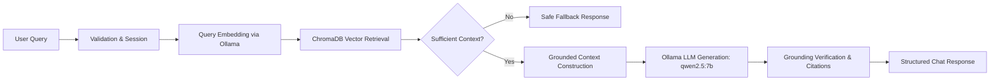

# GenAI Conversational AI Platform 

[](https://www.python.org/)
[](https://fastapi.tiangolo.com/)
[](https://ollama.com/)
[](https://www.trychroma.com/)
[](LICENSE)

An enterprise-grade, modular foundation for a Conversational AI Platform with local RAG, persistent vector search, grounded LLM generation, and comprehensive evaluation metrics.

---

## 1. Project Objective

This platform establishes the core AI behavior, knowledge retrieval (RAG), response quality guardrails, and evaluation infrastructure for our Conversational AI Platform under our team's BRS/FRS specifications.

### Phase 1 Hard Constraints
* **100% Local Execution**: All inference and vector operations run strictly on the local machine or internal container stack.
* **Ollama Runtime**: Local daemon (`http://localhost:11434`) hosting `qwen2.5:7b` (generation) and `nomic-embed-text` (embeddings).
* **Zero External Cloud AI**: Prohibited from calling Gemini API, OpenAI API, Anthropic API, or paid cloud inference providers.
* **Deterministic RAG & Anti-Hallucination**: The system answers strictly from retrieved context chunks. If context is missing or confidence is low, it invokes deterministic fallback routines.
* **No Agentic/Autonomous Loops**: Phase 1 is a clean, reliable, inspectable RAG pipeline.

---

## 2. Architecture Overview



---

## 3. Repository Structure

```
genai-platform/
  app/
    main.py                       # FastAPI application entrypoint & exception handlers
    core/
      config.py                   # Centralized Pydantic settings & environment loader
      logging.py                  # Standardized structured logging configuration
      exceptions.py               # Domain-specific exception hierarchy
    api/
      routes/
        health.py                 # Platform & Ollama connectivity health routes
        chat.py                   # POST /api/v1/chat RAG conversational endpoint
        knowledge.py              # Knowledge ingestion & document management routes
      schemas/
        chat.py                   # ChatRequest, ChatResponse, SourceReference schemas
        knowledge.py              # IngestionRequest, IngestionResponse, Document schemas
        common.py                 # Standard response envelopes and health schemas
    services/
      llm_service.py              # Local LLM text generation service
      embedding_service.py        # Local vector embedding service
      retrieval_service.py        # Semantic search & score thresholding service
      rag_service.py              # End-to-end RAG orchestrator
      conversation_service.py     # Multi-turn session & history memory service
      evaluation_service.py       # Groundedness, hit rate, and MRR evaluation service
    providers/
      ollama/
        client.py                 # Reusable HTTP client for local Ollama runtime
        generation.py             # Ollama /api/generate wrapper
        embeddings.py             # Ollama /api/embeddings wrapper
    ingestion/
      loaders/
        base.py                   # Abstract BaseLoader and RawDocument definitions
        pdf_loader.py             # PDF extraction with page-level tracking
        docx_loader.py            # DOCX extractor with table and paragraph support
        text_loader.py            # Plain text, Markdown, JSON, and CSV loader
      processor.py                # Text normalization and SHA-256 deduplication
      chunker.py                  # Configurable sliding-window recursive chunker
      metadata.py                 # Metadata builder and chunk enrichment
      pipeline.py                 # Coordinated IngestionPipeline
    vectorstore/
      base.py                     # BaseVectorStore abstract interface
      chroma_store.py             # Persistent local ChromaDB adapter
    prompts/
      system.txt                  # System persona & grounding constraints
      rag.txt                     # Grounded context-based QA template
      clarification.txt           # Ambiguous query clarification template
      fallback.txt                # Insufficient information fallback template
    evaluation/
      metrics.py                  # Retrieval and generation quality metric calculators
      test_cases/
        benchmark_cases.json      # Reference evaluation benchmark test suite
    utils/
      text_cleaner.py             # Unicode normalizer and control character stripper
      validators.py               # Query and file extension validation utilities
  data/
    documents/                    # Source files for batch ingestion
    processed/                    # Processed artifact staging
    chroma/                       # ChromaDB persistent local directory
  tests/
    unit/                         # Unit tests (Mocked Ollama, isolated components)
    integration/                  # API route integration tests
    fixtures/                     # Sample text and markdown documents
  scripts/
    setup_ollama.sh               # Ollama verification and model download script
    ingest_documents.py           # CLI script for batch document ingestion
  docs/
    ARCHITECTURE.md               # Detailed system architecture and sequence diagrams
    API_CONTRACTS.md              # Complete REST API specifications
    MODULE_OWNERSHIP.md           # Team module assignments and boundary contracts
    DEVELOPMENT_GUIDE.md          # Local developer setup and contribution workflow
    INTEGRATION_GUIDE.md          # Main backend engineering integration manual
  .env.example                    # Sample environment variable configuration
  .gitignore                      # Comprehensive Git ignore rules
  requirements.txt                # Python project dependencies
  pyproject.toml                  # Python package configuration and tool settings
  Dockerfile                      # Production container image
  docker-compose.yml              # Multi-container local stack (FastAPI + Ollama)
  README.md                       # Platform documentation
```

---

## 4. Prerequisites & Installation

### 4.1 Prerequisites
* Python 3.9+
* Local [Ollama](https://ollama.com) installation

### 4.2 Python Environment Setup
```bash
# Clone the repository
git clone <repo-url>
cd genai-platform

# Create and activate virtual environment
python3 -m venv .venv
source .venv/bin/activate

# Install dependencies
pip install --upgrade pip
pip install -r requirements.txt
pip install -e ".[dev]"

# Configure environment variables
cp .env.example .env
```

### 4.3 Ollama Setup & Model Pulling
Start the Ollama daemon:
```bash
ollama serve
```

In another terminal, pull the required Phase 1 models:
```bash
./scripts/setup_ollama.sh
# Or pull manually:
ollama pull qwen2.5:7b
ollama pull nomic-embed-text
```

---

## 5. Running the Application

```bash
uvicorn app.main:app --reload --host 0.0.0.0 --port 8000
```

### Endpoints
* **API Documentation**: [http://localhost:8000/docs](http://localhost:8000/docs)
* **Health Check**: `GET /api/v1/health`
* **Ollama Diagnostic**: `GET /api/v1/health/ollama`
* **Chat Endpoint**: `POST /api/v1/chat`
* **Knowledge Ingestion**: `POST /api/v1/knowledge/ingest`
* **Document Inventory**: `GET /api/v1/knowledge`
* **Delete Document**: `DELETE /api/v1/knowledge/{document_id}`

---

## 6. Running Tests

```bash
# Run all unit and integration tests
pytest

# Run with test coverage
pytest --cov=app tests/
```

---

## 7. Team Collaboration

Refer to [docs/MODULE_OWNERSHIP.md](docs/MODULE_OWNERSHIP.md) for full module boundaries, owner roles, input/output interfaces, and recommended first tasks.

