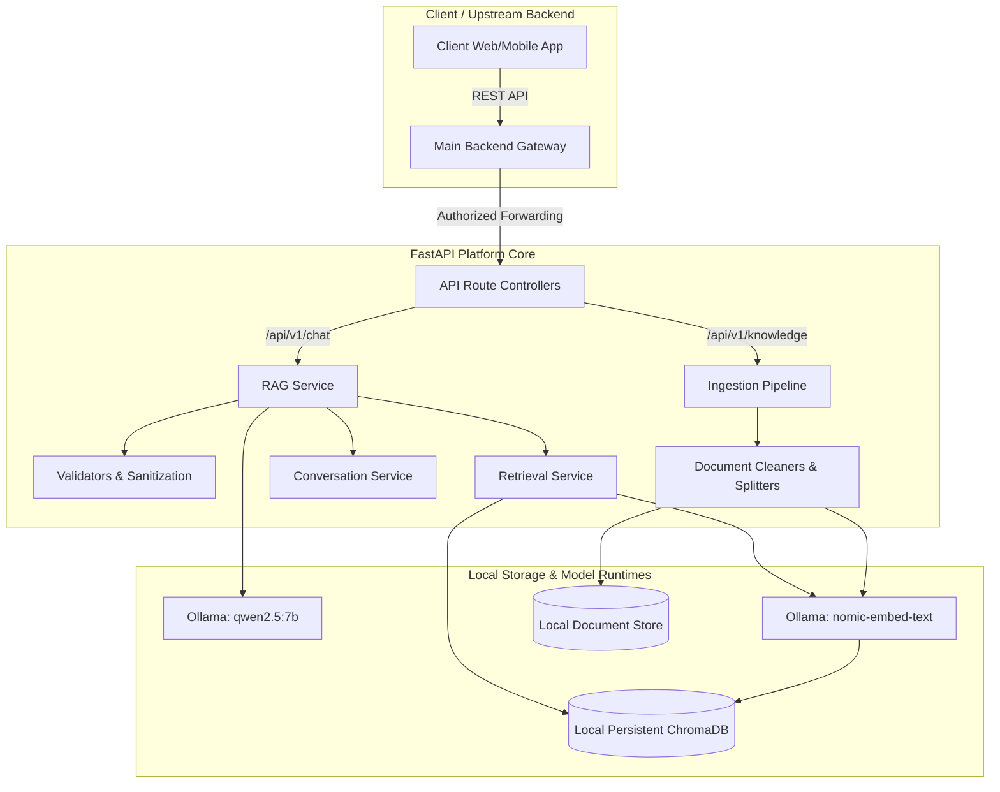
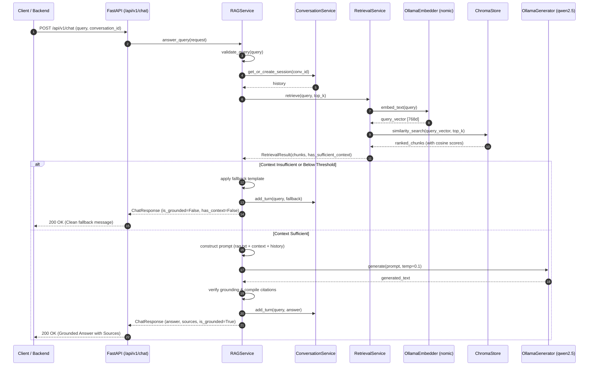
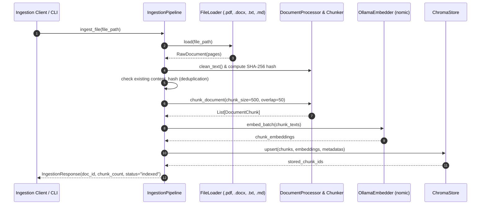

# System Architecture — GenAI Conversational Platform

## 1. Executive Summary & Context

This document outlines the architectural blueprint for the enterprise **Conversational AI Platform**. The GenAI team's scope covers AI behavior, knowledge retrieval (RAG), response quality, local model integration, and evaluation.

### Phase 1 Operational Constraints
* **100% Local Execution**: All inference and vector operations run strictly on the local machine or internal container stack.
* **Ollama Runtime**: Local daemon (`http://localhost:11434`) hosting `qwen2.5:7b` (generation) and `nomic-embed-text` (embeddings).
* **Zero External Cloud AI**: Prohibited from calling Gemini API, OpenAI API, Anthropic API, or paid cloud inference providers.
* **Deterministic RAG & Anti-Hallucination**: The system answers strictly from retrieved context chunks. If context is missing or confidence is low, it invokes deterministic fallback routines.
* **No Agentic/Autonomous Loops**: Phase 1 is a clean, reliable, inspectable RAG pipeline.

---

## 2. High-Level System Architecture

---

## 3. Data Pipelines & Execution Flows

### 3.1 End-to-End Query & RAG Synthesis Flow

### 3.2 Document Ingestion Flow

---

## 4. Key Architectural Decisions

1. **Local Persistent ChromaDB**:
   - Zero-network overhead, eliminates cloud vector DB egress costs and latency.
   - Persists locally at `./data/chroma`.
   - Uses cosine distance metric (`hnsw:space = "cosine"`).
2. **Provider Isolation Pattern**:
   - Direct Ollama calls are encapsulated in `app/providers/ollama/`.
   - Higher layers (`RAGService`, `IngestionPipeline`) consume abstract services (`LLMService`, `EmbeddingService`), ensuring future swapability without touching business logic.
3. **Traceability & Grounding**:
   - Every chunk receives a deterministic unique ID: `{doc_id}#c{index:04d}`.
   - Metadata stores `filename`, `page_number`, `chunk_index`, and `content_hash`.
   - Prompt engineering explicitly instructs the LLM to refer only to provided context and emit source references.

